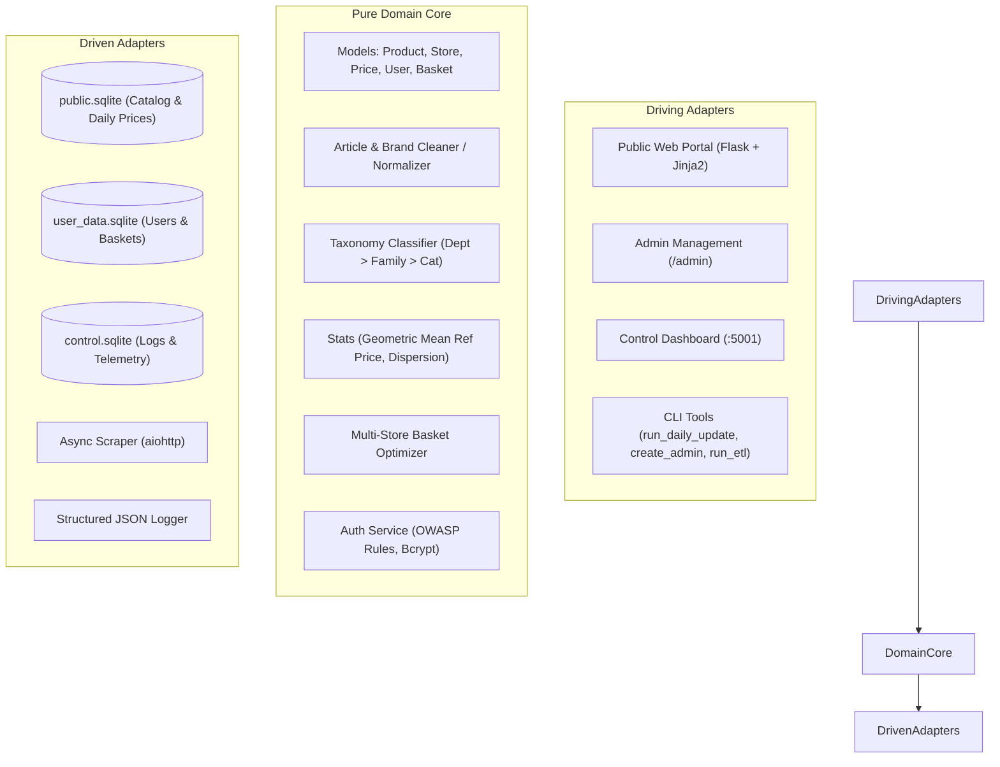
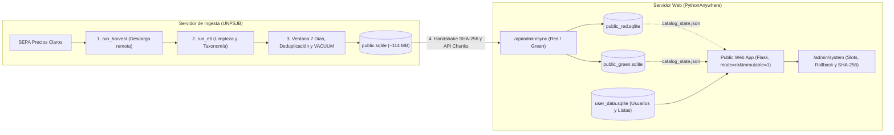

# 🛒 Sur en Precios — Supermarket Price Harvester & Optimizer

> **Clean, Hexagonal Architecture System for harvesting, processing, analyzing, and querying daily supermarket prices from Argentina's official SEPA (*Precios Claros*) dataset (`datos.produccion.gob.ar/dataset/sepa-precios`).**

---

## 🏛️ System Architecture Overview

**Sur en Precios** isolates core domain logic from framework, storage, and scraper details following **Hexagonal Architecture (Ports and Adapters)**:



- **Pure Domain Core** (`sur_en_precios.domain`):
  - **Models**: Framework-free domain models (`Product`, `Store`, `DailyPrice`, `User`, `Basket`, `BasketItem`).
  - **Cleaning & Normalization** (`cleaner`): Standardizes raw supermarket text, isolates brands, and parses metric package sizes.
  - **Taxonomy Engine** (`taxonomy`): Classifies articles into a 3-tier hierarchy (*Department* &rarr; *Family* &rarr; *Category*).
  - **Price Analytics**: Reference Price via Geometric Mean, price dispersion indices, and regional basket optimization across nearby supermarkets.
  - **Security & Authentication** (`AuthService`): OWASP password validation, Bcrypt hashing (cost factor 12), and timing-attack resistant verification.
- **Driving Adapters** (`sur_en_precios.web` & `sur_en_precios.tools`):
  - **Public Web Portal** (`public_app`): Product catalog search, category navigation, basket building, store price comparison, and user accounts.
  - **Admin Management Portal** (`/admin` within `public_app`): Single-admin management of users, basket inspection, catalog health metrics, and manual update triggers.
  - **Control Dashboard** (`control_app`): Service telemetry and harvest execution tracking.
  - **CLI Tools**: Single-admin bootstrap (`create_admin`), daily harvest + ETL orchestrator (`run_daily_update`), stand-alone scraper (`run_harvest`), regional processor (`run_etl`), and log analyzer (`log_analyzer`).
- **Driven Adapters** (`sur_en_precios.adapters`):
  - **Multi-Database SQLite Architecture**: Decoupled database architecture with SQLite WAL mode and foreign key enforcement.
  - **SQLAlchemy 2.0 Repositories**: Type-safe data mapping, indexed queries, and cascade deletions.
  - **Async HTTP Scraper**: Automated remote discovery and download of daily SEPA archives via `aiohttp`.

---

## 🗄️ Database Architecture & Decoupled Storage

All persistent data and configuration are housed by default in `~/Info/sur_en_precios/`. The system uses three independent SQLite databases to guarantee isolation and zero data loss:

| Database | File | Purpose | Persistence Lifecycle |
| :--- | :--- | :--- | :--- |
| **Public Catalog** | `public_red.sqlite` / `public_green.sqlite` *(local build: `public.sqlite`)* | Stores regional stores, products, daily prices, and reference prices. | **Swapped atomically daily** via zero-downtime **Red / Green** slot rotation (`catalog_state.json`). |
| **User Data** | `user_data.sqlite` | Stores user credentials, hashed passwords, shopping baskets, and saved items. | **Permanent**. Never touched or wiped during catalog updates. |
| **Control / Audit** | `control.sqlite` | Records pipeline execution timings, download sizes, error traces, and audit logs. | **Permanent** append-only operational telemetry. |

> [!IMPORTANT]
> **EAN-Decoupled Baskets**: To allow daily catalog regeneration without breaking saved baskets, `BasketItem` references items by standard **`ean` (barcode)** rather than internal database foreign keys. Even when the active catalog switches between `public_red.sqlite` and `public_green.sqlite`, user baskets seamlessly link to the newest product data.

Active Red/Green catalog slots on the public web server are opened in lock-free **read-only immutable URI mode** (`file:///...?mode=ro&immutable=1`) to eliminate NFS `fcntl` lock contention across multi-worker uWSGI processes, while mutable SQLite databases (`user_data.sqlite`, `control.sqlite`, and local ETL builds) enforce rollback journal mode and busy timeouts:
```sql
PRAGMA journal_mode = DELETE;
PRAGMA foreign_keys = ON;
PRAGMA busy_timeout = 30000;
```

---

## 🔐 Authentication & Security Model

The web application is engineered for exposure on the public internet (e.g., PythonAnywhere) following strict zero-trust security practices:

### 1. Single Administrator Bootstrap
- The system enforces a **strict single-admin policy** (`count_admins() >= 1` prevents registering or promoting any additional administrator).
- The admin account **cannot be created via the web interface**; it must be provisioned during server deployment using the CLI bootstrap tool (`sur_en_precios.tools.create_admin`).
- The admin has exclusive access to the `/admin` portal to delete users, inspect all public and private baskets, and manage catalog updates.

### 2. Zero-Recovery User Accounts
- **Privacy First**: No email addresses, phone numbers, or PII (Personally Identifiable Information) are ever collected or stored.
- Accounts consist solely of a pseudonymous **`username`** and a secure **`password`**.
- **No Password Recovery**: Users cannot recover lost credentials. Registration requires explicit confirmation of this disclaimer via a mandatory acknowledgment checkbox.

### 3. Password Standards & Protection
- **OWASP Compliance**: Minimum 10 characters, requiring both letters and digits or symbols. Rejects passwords containing the username, reversed username, or entries found on common password blacklists.
- **Bcrypt Work Factor 12**: Strong, salted password hashing.
- **Anti-Timing Attack Protection**: Authentication runs constant-time dummy verification on invalid usernames to prevent user enumeration via timing discrepancies.
- **Session & CSRF Security**: Signed session cookies and CSRF tokens across all form submissions and state mutations.

---

## ⚡ Requirements & Prerequisites

- **Python 3.12+**
- **`uv`** (fast Python package and project manager)

To verify `uv` installation:
```bash
uv --version
```
If missing, install `uv` via:
```bash
curl -LsSf https://astral.sh/uv/install.sh | sh
```

---

## ⚙️ Installation

Clone the repository and install all dependencies in the local virtual environment using `uv`:

```bash
git clone https://github.com/DanielBerns/sur_en_precios.git
cd sur_en_precios/sur_en_precios
uv sync
```

This automatically locks dependencies and installs the `sur-en-precios` package in editable mode.

---

## 🔧 Configuration

The application resolves its working directory and configuration dynamically using a 3-tier hierarchy:

1. **CLI Argument**: `--workdir /path/to/workdir`
2. **Environment Variable**: `WORKING_DIRECTORY=/path/to/workdir`
3. **Fallback Default**: `~/Info/sur_en_precios`

### Generating Configuration (`config.yaml`)

Run any tool with the `--create` flag to generate the default `config.yaml` file inside the working directory:

```bash
uv run python -m sur_en_precios.tools.run_etl --create
```

### Configuration Schema (`config.yaml`)

```yaml
app:
  name: "Sur en Precios"
  region: "AR-U"               # ISO 3166-2 Argentine Province Code (e.g. AR-U for Chubut, AR-B for Buenos Aires)
  debug: false

database:
  public_db_filename: "public.sqlite"      # Daily swapped region price DB
  user_db_filename: "user_data.sqlite"   # User accounts & saved shopping lists DB
  control_db_filename: "control.sqlite"   # System execution & audit logs DB

etl:
  generate_sample_data: false   # Feature flag: set true to generate mock CSVs when raw SEPA data is missing
  insert_batch_size: 10000      # Rows per bulk upsert batch
  temp_dir: "data/tmp"          # Directory for temporary extraction

scraper:
  sepa_url: "https://datos.produccion.gob.ar/dataset/sepa-precios"
  raw_storage_dir: "data/raw"
  timeout_seconds: 120

logging:
  level: "INFO"
  log_dir: "logs"
  max_bytes: 10485760          # 10MB rotation
  backup_count: 5
```

---

## 🛡️ Initial Server Deployment: Create Single Admin

Before launching the web portal or exposing it to users, initialize the single administrator account via CLI:

```bash
uv run python -m sur_en_precios.tools.create_admin --username <admin_username>
```

The tool will securely prompt for the administrator password with confirmation and enforce OWASP security requirements.

> [!NOTE]
> If an administrator account already exists in `user_data.sqlite`, subsequent execution of `create_admin` will be rejected.

---

## 🔄 Daily Database Updates & Architecture (UNPSJB &rarr; PythonAnywhere)

Due to resource, CPU execution, and storage quotas (512 MB free tier) on PythonAnywhere, daily dataset harvesting, heavy regional ETL transformations, and deduplication **do not run directly on PythonAnywhere**.

Instead, the system employs an off-host batch processing architecture with **zero-downtime Red / Green slot updates** and progressive chunk streaming:



---

### 🧩 The 4 Pipeline Phases of `run_daily_update`

When `sur_en_precios.tools.run_daily_update` runs, it executes four specialized phases sequentially:

1. **Harvest Phase (`run_harvest`)**:
   - Queries `datos.produccion.gob.ar/dataset/sepa-precios` for new compressed archives.
   - **Smart Skip Optimization**: If today's archives have no new files and `public.sqlite` is already present, the pipeline automatically skips local ETL regeneration while still verifying remote synchronization so previously failed uploads self-heal automatically. (Use `--force` to bypass this check).

2. **Regional ETL & Data Normalization (`run_etl`)**:
   - Filters the national dataset down to the configured target province (e.g. `AR-U` for Chubut).
   - Standardizes messy supermarket product descriptions, extracts brand names, parses metric package sizes, and categorizes products into the 3-tier taxonomy (*Department* &rarr; *Family* &rarr; *Category*).

3. **7-Day Rolling Window, Deduplication & Physical Compaction**:
   - **7-Day Purge**: Deletes price observations older than 7 days (`delete_prices_before_date`) to maintain a lean, current price catalog.
   - **Latest-Price Deduplication**: Deduplicates `DailyPrice` records using SQLite window functions (`deduplicate_prices_keep_latest`), keeping only the single most recent price observation per `(ean, store_code)` within that 7-day window.
   - **Reference Price Recalculation**: Recomputes geometric mean reference prices and price dispersion metrics across all active store prices in the city.
   - **SQLite `VACUUM` Compaction**: Reclaims deleted disk pages in SQLite. This reduces `public.sqlite` from **>296 MB down to ~114 MB** (~29 MB gzipped), keeping dual-slot Red/Green storage (`~228 MB` peak) safely within PythonAnywhere's 512 MB quota.

4. **Zero-Downtime Red / Green Web Synchronization (`sync_client`)**:
   - Governed entirely by the `sync.sync_to_web` flag in `config.yaml` (**zero CLI flags required** for automated sync).
   - **Local Preparation & Pre-Flight SHA-256 Handshake**: Enforces `PRAGMA journal_mode = DELETE` locally, verifies `PRAGMA integrity_check`, and queries `GET /api/admin/sync/status` on PythonAnywhere. If the remote active slot SHA-256 matches the local database, upload is skipped (`SKIPPED_IDENTICAL_HASH`).
   - **Zero-Downtime Session Start (`POST /api/admin/sync/start`)**: Selects the inactive slot (`red` if `green` is active, or `green` if `red` is active) and reclaims any prior file in that inactive slot while the active slot continues serving live public traffic (`HTTP 200`, no `503` maintenance lock).
   - **Chunked Transfer (`PUT /api/admin/sync/chunk/<upload_id>/<idx>`)**: Streams compressed chunks (default 2 MB) with automatic retry/backoff into an isolated staging directory.
   - **Single-Pass Streaming Cutover (`POST /api/admin/sync/finish/<upload_id>`)**: Stream-decompresses chunks while unlinking each `.part` file on EOF (eliminating temporary archive peak overhead), verifies both compressed and uncompressed SHA-256 digests, runs lock-free read-only `PRAGMA integrity_check` (`mode=ro&immutable=1`), atomically renames the candidate into `public_<slot>.sqlite`, and atomically flips `catalog_state.json`. All uWSGI workers automatically rebind to the new slot on their next request without server reload.

---

### 💻 How to Run the Daily Update Manually

From the `sur_en_precios/sur_en_precios` directory on the UNPSJB computer:

#### 1. Standard Run
Executes the full pipeline, automatically skipping redundant local ETL if no new SEPA files exist and skipping remote upload if the active remote slot SHA-256 already matches:
```bash
uv run python -m sur_en_precios.tools.run_daily_update
```

#### 2. Forced Regeneration
Forces re-download of SEPA archives, full ETL processing, 7-day window deduplication, and upload regardless of cache status:
```bash
uv run python -m sur_en_precios.tools.run_daily_update --force
```

#### 3. Custom Working Directory
```bash
uv run python -m sur_en_precios.tools.run_daily_update --workdir ~/Info/sur_en_precios
```

#### 4. Standalone Catalog Upload (Push Existing Database)
If `public.sqlite` has already been generated and you only need to push it to PythonAnywhere:
```bash
uv run python -m sur_en_precios.tools.sync_client
```

#### 5. Instant Remote Rollback (Revert to Previous Slot)
If `retain_previous_slot: true` (default), you can atomically switch PythonAnywhere back to the previous validated Red/Green slot in milliseconds (also available via `/admin/system` in the browser):
```bash
uv run python -m sur_en_precios.tools.sync_client --rollback
```

---

### ⏰ Automating Daily Updates via Cron (UNPSJB Ingestion Server)

To run the update automatically every morning, add a cron job on the UNPSJB server:

1. Open crontab:
   ```bash
   crontab -e
   ```

2. Add the scheduled execution entry (for example, daily at 06:00 AM):
   ```cron
   # Sur en Precios — Daily Price Harvest, ETL and Sync to PythonAnywhere
   0 6 * * * cd /home/dberns/Projects/github/DanielBerns/sur_en_precios/sur_en_precios && /home/dberns/.local/bin/uv run python -m sur_en_precios.tools.run_daily_update >> /home/dberns/Info/sur_en_precios/logs/cron_sync.log 2>&1
   ```

> [!TIP]
> Always use the absolute path to the `uv` executable (run `which uv` to find it, typically `~/.local/bin/uv` or `~/.cargo/bin/uv`) so that cron's restricted environment can locate it.

---

### ⚙️ Sync Configuration (`config.yaml`)

Synchronization to the public server requires matching secret API tokens in `config.yaml` on both machines:

#### 1. Generating a Secure API Token
Run this in Python to create a secure 64-character token:
```bash
python -c "import secrets; print(secrets.token_urlsafe(64))"
```

#### 2. On the UNPSJB Server (`~/Info/sur_en_precios/config.yaml`)
Set the target region (`AR-U` for Chubut), enable `sync_to_web`, and configure the target server and credentials:
```yaml
app:
  region: "AR-U"                                # Chubut (ISO 3166-2)

sync:
  sync_to_web: true                             # Enable remote synchronization
  server_url: "https://<tu_usuario>.pythonanywhere.com"
  api_token: "TU_TOKEN_SECRETO_GENERADO_DE_64_CARACTERES"
  chunk_size_bytes: 2097152                    # 2 MB per stream chunk
  timeout_seconds: 900                         # 15 minutes max
```

#### 3. On the PythonAnywhere Server (`~/Info/sur_en_precios/config.yaml`)
On the receiving server, set matching `app.region` (`AR-U`) and keep `sync_to_web` set to `false`:
```yaml
app:
  region: "AR-U"                                # Chubut (ISO 3166-2)

sync:
  sync_to_web: false                            # Web host is receiver only
  api_token: "TU_TOKEN_SECRETO_GENERADO_DE_64_CARACTERES"
  retain_previous_slot: true                    # Keep standby slot for instant rollback (set false to delete immediately after cutover)
```

> [!NOTE]
> Automated sync activation is controlled **strictly via `config.yaml`** (`sync.sync_to_web: true`).

---

### 📊 Monitoring, Logs & Verification

#### 1. Checking the Cron Execution Log
```bash
tail -n 50 ~/Info/sur_en_precios/logs/cron_sync.log
```

#### 2. Querying Structured Telemetry (`log_analyzer`)
All pipeline executions and sync results are recorded in `control.sqlite`. Inspect them using the built-in analyzer:
```bash
# Print summary of recent harvest and sync jobs
uv run python -m sur_en_precios.tools.log_analyzer --summary

# Tail recent execution log entries
uv run python -m sur_en_precios.tools.log_analyzer --tail 25
```

#### 3. Remote Verification & Rollback in Web Dashboard
Log in as administrator and visit `/admin/system` (e.g., `https://<tu_usuario>.pythonanywhere.com/admin/system`):
- **Red / Green Slot Status**: Displays the active slot (`RED` or `GREEN`), standby slot availability, file size, last modification time, and read-only immutable SQLite mode.
- **Instant Rollback**: One-click button to atomically revert to the standby slot when available.
- **SHA-256 Checksum**: Displays the active remote database hash matching the local catalog.
- **Catalog Metrics**: Total products, active stores, and regional price counts.
- **Sync History**: Audit trail of recent remote uploads and rollbacks with timestamps and durations.

---

## 🚀 Running the Web Applications

### 1. Launch the Public Web Portal

Full-featured web application with product search, category navigation, basket optimization, and user authentication:

```bash
uv run python -m sur_en_precios.web.public_app.app
```
Open browser at: `http://localhost:5000`

- **Catalog & Search**: Search products by description, filter by brand, browse categories (*Department &rarr; Family &rarr; Category*).
- **User Authentication**: Register (`/auth/register`), Log In (`/auth/login`), Log Out (`/auth/logout`).
- **Shopping Baskets**: Create personal baskets, add items by barcode (EAN), toggle public/private sharing, and run multi-store price optimization.

### 2. Admin Management Portal (`/admin`)

When logged in with the administrator account, the navigation bar displays a direct link to the **Admin Portal**:

- **Dashboard (`/admin`)**: System overview, active users, total baskets, catalog status.
- **User Management (`/admin/users`)**: Inspect all registered users and last login timestamps; delete users with cascade removal of their baskets.
- **Basket Audit (`/admin/baskets`)**: Audit and inspect all shopping lists (both public and private) and review item contents.
- **Estado del Catálogo (`/admin/system`)**: Diagnóstico de slots Red / Green (`public_red.sqlite` / `public_green.sqlite`), rollback instantáneo al slot anterior, métricas del catálogo público e historial de telemetría.

### 3. Launch the Private Control Dashboard

Standalone dashboard monitoring ETL job execution status, file sizes, and errors:

```bash
uv run python -m sur_en_precios.web.control_app.app
```
Open browser at: `http://localhost:5001`  
*(Default Credentials: `admin` / `sur_precios_2026`)*

### 4. Deploying to PythonAnywhere (Virtualenv & `pip`)

PythonAnywhere uses `pip` inside virtual environments. The production `requirements.txt` is exported directly via `uv`:

```bash
# Generated using uv:
# uv export --no-dev --no-emit-project --no-hashes -o requirements.txt

# In PythonAnywhere Bash Console (Python 3.10):
mkvirtualenv --python=python3.10 sur-en-precios-env
pip install -r requirements.txt
pip install -e ./sur_en_precios
```

In the PythonAnywhere **Web** tab:
1. Set **Virtualenv** to: `/home/<your-username>/.virtualenvs/sur-en-precios-env`
2. In the **WSGI configuration file** (`/var/www/<your-username>_pythonanywhere_com_wsgi.py`):

```python
import sys

project_home = "/home/<your-username>/sur_en_precios/sur_en_precios/src"
if project_home not in sys.path:
    sys.path.insert(0, project_home)

from sur_en_precios.web.public_app.app import create_app

application = create_app()
```

---

## 🛠️ CLI Tools Reference

| Tool | Module Path | Purpose | Key Arguments |
| :--- | :--- | :--- | :--- |
| **Create Admin** | `sur_en_precios.tools.create_admin` | Bootstraps the unique server administrator. | `--username`, `--password`, `--workdir` |
| **Daily Update** | `sur_en_precios.tools.run_daily_update` | Orchestrates daily harvest + regional ETL + logging + Red/Green sync. | `--workdir`, `--force` |
| **Sync Client** | `sur_en_precios.tools.sync_client` | Streams `public.sqlite` to the inactive Red/Green slot or triggers rollback. | `--workdir`, `--rollback` |
| **Run Harvest** | `sur_en_precios.tools.run_harvest` | Scrapes remote SEPA web portal and downloads archives. | `--workdir`, `--force`, `--create` |
| **Run ETL** | `sur_en_precios.tools.run_etl` | Processes raw CSV files into regional `public.sqlite`. | `--region`, `--date`, `--workdir`, `--create` |
| **Log Analyzer** | `sur_en_precios.tools.log_analyzer` | Queries and filters structured JSON execution logs. | `--summary`, `--level`, `--search`, `--tail` |

---

## 🧪 Testing & Code Quality Assurance

Run the complete verification suite using `uv`:

```bash
# 1. Linting & Import Sorting Check
uv run ruff check .

# 2. Code Formatting Check
uv run ruff format --check .

# 3. Static Type Analysis
uv run mypy src/

# 4. Automated Pytest Test Suite
uv run pytest
```

---

## 📄 License

Distributed under the MIT License. See `LICENSE` for details.
