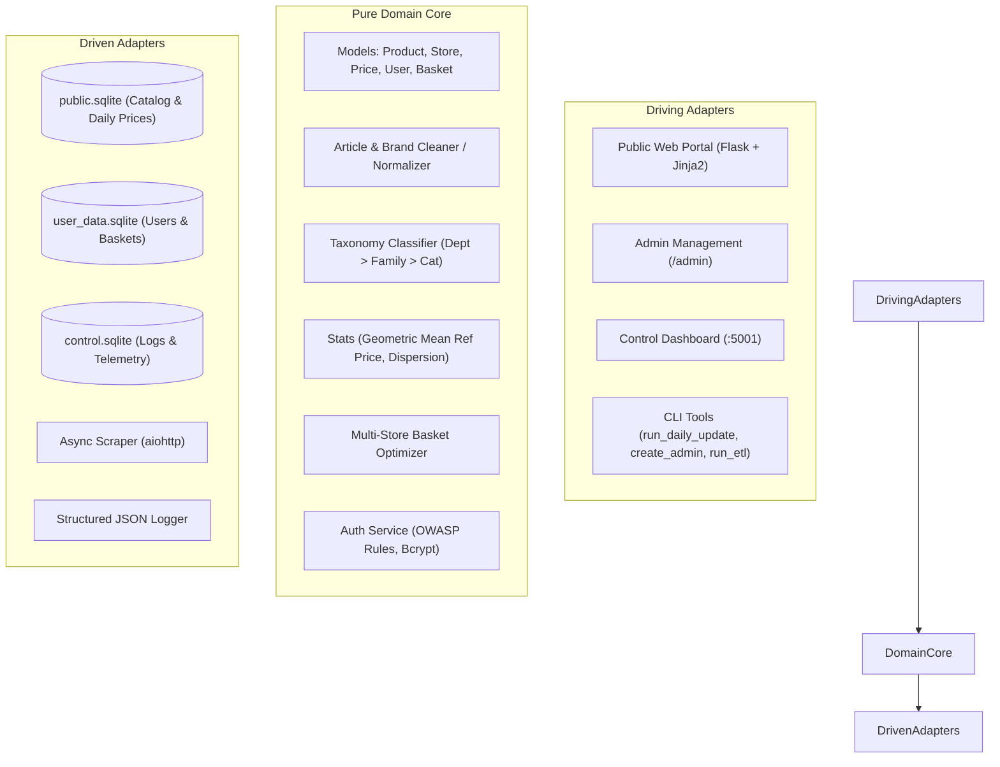
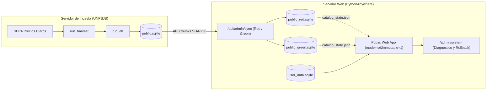

# 🛒 Sur en Precios — Supermarket Price Harvester & Optimizer

> **Clean, Hexagonal Architecture System for harvesting, processing, analyzing, and querying daily supermarket prices from Argentina's official SEPA (*Precios Claros*) dataset (`datos.produccion.gob.ar/dataset/sepa-precios`).**

---

## 🏛️ System Architecture Overview

**Sur en Precios** isolates core domain logic from framework, storage, and scraper details following **Hexagonal Architecture (Ports and Adapters)**:



- **Pure Domain Core** (`sur_en_precios.domain`):
  - **Models**: Framework-free domain models (`Product`, `Store`, `DailyPrice`, `User`, `Basket`, `BasketItem`).
  - **Cleaning & Normalization** (`cleaner`): Standardizes raw supermarket text, isolates brands, and parses metric package sizes.
  - **Taxonomy Engine** (`taxonomy`): Classifies articles into a 3-tier hierarchy (*Department* &rarr; *Family* &rarr; *Category*).
  - **Price Analytics**: Reference Price via Geometric Mean, price dispersion indices, and regional basket optimization across nearby supermarkets.
  - **Security & Authentication** (`AuthService`): OWASP password validation, Bcrypt hashing (cost factor 12), and timing-attack resistant verification.
- **Driving Adapters** (`sur_en_precios.web` & `sur_en_precios.tools`):
  - **Public Web Portal** (`public_app`): Product catalog search, category navigation, basket building, store price comparison, and user accounts.
  - **Admin Management Portal** (`/admin` within `public_app`): Single-admin management of users, basket inspection, catalog health metrics, and manual update triggers.
  - **Control Dashboard** (`control_app`): Service telemetry and harvest execution tracking.
  - **CLI Tools**: Single-admin bootstrap (`create_admin`), daily harvest + ETL orchestrator (`run_daily_update`), stand-alone scraper (`run_harvest`), regional processor (`run_etl`), and log analyzer (`log_analyzer`).
- **Driven Adapters** (`sur_en_precios.adapters`):
  - **Multi-Database SQLite Architecture**: Decoupled database architecture with SQLite WAL mode and foreign key enforcement.
  - **SQLAlchemy 2.0 Repositories**: Type-safe data mapping, indexed queries, and cascade deletions.
  - **Async HTTP Scraper**: Automated remote discovery and download of daily SEPA archives via `aiohttp`.

---

## 🗄️ Database Architecture & Decoupled Storage

All persistent data and configuration are housed by default in `~/Info/sur_en_precios/`. The system uses three independent SQLite databases to guarantee isolation and zero data loss:

| Database | File | Purpose | Persistence Lifecycle |
| :--- | :--- | :--- | :--- |
| **Public Catalog** | `public.sqlite` | Stores regional stores, products, daily prices, and reference prices. | **Rebuilt / swapped daily** via the automated ETL pipeline. |
| **User Data** | `user_data.sqlite` | Stores user credentials, hashed passwords, shopping baskets, and saved items. | **Permanent**. Never touched or wiped during catalog updates. |
| **Control / Audit** | `control.sqlite` | Records pipeline execution timings, download sizes, error traces, and audit logs. | **Permanent** append-only operational telemetry. |

> [!IMPORTANT]
> **EAN-Decoupled Baskets**: To allow daily catalog regeneration without breaking saved baskets, `BasketItem` references items by standard **`ean` (barcode)** rather than internal database foreign keys. Even if `public.sqlite` is completely re-created, user baskets seamlessly link to the newest product data.

All SQLite connections enforce busy timeouts and referential integrity (using standard rollback journal mode on network storage like PythonAnywhere NFS to eliminate `-shm` locking conflicts):
```sql
PRAGMA journal_mode = DELETE;
PRAGMA foreign_keys = ON;
PRAGMA busy_timeout = 30000;
```

---

## 🔐 Authentication & Security Model

The web application is engineered for exposure on the public internet (e.g., PythonAnywhere) following strict zero-trust security practices:

### 1. Single Administrator Bootstrap
- The system enforces a **strict single-admin policy** (`count_admins() >= 1` prevents registering or promoting any additional administrator).
- The admin account **cannot be created via the web interface**; it must be provisioned during server deployment using the CLI bootstrap tool (`sur_en_precios.tools.create_admin`).
- The admin has exclusive access to the `/admin` portal to delete users, inspect all public and private baskets, and manage catalog updates.

### 2. Zero-Recovery User Accounts
- **Privacy First**: No email addresses, phone numbers, or PII (Personally Identifiable Information) are ever collected or stored.
- Accounts consist solely of a pseudonymous **`username`** and a secure **`password`**.
- **No Password Recovery**: Users cannot recover lost credentials. Registration requires explicit confirmation of this disclaimer via a mandatory acknowledgment checkbox.

### 3. Password Standards & Protection
- **OWASP Compliance**: Minimum 10 characters, requiring both letters and digits or symbols. Rejects passwords containing the username, reversed username, or entries found on common password blacklists.
- **Bcrypt Work Factor 12**: Strong, salted password hashing.
- **Anti-Timing Attack Protection**: Authentication runs constant-time dummy verification on invalid usernames to prevent user enumeration via timing discrepancies.
- **Session & CSRF Security**: Signed session cookies and CSRF tokens across all form submissions and state mutations.

---

## ⚡ Requirements & Prerequisites

- **Python 3.12+**
- **`uv`** (fast Python package and project manager)

To verify `uv` installation:
```bash
uv --version
```
If missing, install `uv` via:
```bash
curl -LsSf https://astral.sh/uv/install.sh | sh
```

---

## ⚙️ Installation

Requires Python 3.12+ and [uv](https://docs.astral.sh/uv/).

Clone the repository and install all dependencies in the local virtual environment using `uv`:

```bash
git clone https://github.com/DanielBerns/sur_en_precios.git
cd sur_en_precios/sur_en_precios
uv sync
```

This automatically locks dependencies and installs the `sur-en-precios` package in editable mode.

---

## 🔧 Configuration

The application resolves its working directory and configuration dynamically using a 3-tier hierarchy:

1. **CLI Argument**: `--workdir /path/to/workdir`
2. **Environment Variable**: `WORKING_DIRECTORY=/path/to/workdir`
3. **Fallback Default**: `~/Info/sur_en_precios`

### Initializing Workdir and Configuration (`config.yaml`)

Run the `start` tool to generate the default `config.yaml`, set up required directories, and initialize the SQLite databases:

```bash
uv run python -m sur_en_precios.tools.start --workdir /path/to/workdir
```

### Configuration Schema (`config.yaml`)

```yaml
app:
  name: "Sur en Precios"
  region: "AR-U"               # ISO 3166-2 Argentine Province Code (e.g. AR-U for Chubut, AR-B for Buenos Aires)
  debug: false

database:
  public_db_filename: "public.sqlite"      # Daily swapped region price DB
  user_db_filename: "user_data.sqlite"   # User accounts & saved shopping lists DB
  control_db_filename: "control.sqlite"   # System execution & audit logs DB

etl:
  generate_sample_data: false   # Feature flag: set true to generate mock CSVs when raw SEPA data is missing
  insert_batch_size: 10000      # Rows per bulk upsert batch
  temp_dir: "data/tmp"          # Directory for temporary extraction

scraper:
  sepa_url: "https://datos.produccion.gob.ar/dataset/sepa-precios"
  raw_storage_dir: "data/raw"
  timeout_seconds: 120

logging:
  level: "INFO"
  log_dir: "logs"
  max_bytes: 10485760          # 10MB rotation
  backup_count: 5
```

---

## 🛡️ Initial Server Deployment: Create Single Admin

Before launching the web portal or exposing it to users, initialize the single administrator account via CLI:

```bash
uv run python -m sur_en_precios.tools.create_admin --username <admin_username>
```

The tool will securely prompt for the administrator password with confirmation and enforce OWASP security requirements.

> [!NOTE]
> If an administrator account already exists in `user_data.sqlite`, subsequent execution of `create_admin` will be rejected.

---

## 🔄 Daily Database Updates & Architecture (UNPSJB &rarr; PythonAnywhere)

Due to resource and CPU execution limits on PythonAnywhere (such as processing tarpit throttling), the daily dataset harvesting and heavy regional ETL processing **does not run directly on PythonAnywhere**.

Instead, the system employs an off-host batch processing architecture with **zero-downtime Red / Green slot updates**:



### 1. Ingestion Server Execution (UNPSJB)

On the dedicated processing server at the **Universidad Nacional de la Patagonia San Juan Bosco (UNPSJB)**, the daily update pipeline is executed via cron:

```bash
# Execute end-to-end harvest + ETL + Red/Green sync pipeline on UNPSJB server
uv run python -m sur_en_precios.tools.run_daily_update --workdir ~/Info/sur_en_precios

# Force re-download even if today's archive is already cached
uv run python -m sur_en_precios.tools.run_daily_update --force
```

This generates a fresh, indexed `public.sqlite` containing all current regional prices, stores, and reference metrics, and automatically synchronizes it when `sync.sync_to_web: true` is set in `config.yaml`.

### 2. Red / Green Synchronization & Instant Rollback (PythonAnywhere)

You can also push an already-built `public.sqlite` or revert to the standby slot on PythonAnywhere directly via `sync_client`:

```bash
# Stream compressed chunks into the inactive Red/Green slot and cut over atomically:
uv run python -m sur_en_precios.tools.sync_client

# Instantly roll back PythonAnywhere to the previous standby slot:
uv run python -m sur_en_precios.tools.sync_client --rollback
```

Because active slots (`public_red.sqlite` / `public_green.sqlite`) are opened in read-only immutable mode and user accounts/baskets reside in `user_data.sqlite` (referencing articles by standard `ean`), cutover happens in milliseconds with zero downtime, zero NFS lock contention, and zero risk to user data.

---

## 🚀 Running the Web Applications

### 1. Launch the Public Web Portal

Full-featured web application with product search, category navigation, basket optimization, and user authentication:

```bash
uv run python -m sur_en_precios.web.public_app.app
```
Open browser at: `http://localhost:5000`

- **Catalog & Search**: Search products by description, filter by brand, browse categories (*Department &rarr; Family &rarr; Category*).
- **User Authentication**: Register (`/auth/register`), Log In (`/auth/login`), Log Out (`/auth/logout`).
- **Shopping Baskets**: Create personal baskets, add items by barcode (EAN), toggle public/private sharing, and run multi-store price optimization.

### 2. Admin Management Portal (`/admin`)

When logged in with the administrator account, the navigation bar displays a direct link to the **Admin Portal**:

- **Dashboard (`/admin`)**: System overview, active users, total baskets, catalog status.
- **User Management (`/admin/users`)**: Inspect all registered users and last login timestamps; delete users with cascade removal of their baskets.
- **Basket Audit (`/admin/baskets`)**: Audit and inspect all shopping lists (both public and private) and review item contents.
- **Estado del Catálogo (`/admin/system`)**: Diagnóstico del archivo `public.sqlite` en disco (tamaño, fecha de sincronización, modo WAL), métricas del catálogo público e historial de telemetría.

### 3. Launch the Private Control Dashboard

Standalone dashboard monitoring ETL job execution status, file sizes, and errors:

```bash
uv run python -m sur_en_precios.web.control_app.app
```
Open browser at: `http://localhost:5001`  
*(Default Credentials: `admin` / `sur_precios_2026`)*

### 4. Deploying to PythonAnywhere (Virtualenv & `pip`)

PythonAnywhere uses `pip` inside virtual environments. The production `requirements.txt` is exported directly via `uv`:

```bash
# Generated using uv:
# uv export --no-dev --no-emit-project --no-hashes -o requirements.txt

# In PythonAnywhere Bash Console (Python 3.10):
mkvirtualenv --python=python3.10 sur-en-precios-env
pip install -r requirements.txt
pip install -e ./
```

In the PythonAnywhere **Web** tab:
1. Set **Virtualenv** to: `/home/<your-username>/.virtualenvs/sur-en-precios-env`
2. In the **WSGI configuration file** (`/var/www/<your-username>_pythonanywhere_com_wsgi.py`):

```python
import sys

project_home = "/home/<your-username>/sur_en_precios/sur_en_precios/src"
if project_home not in sys.path:
    sys.path.insert(0, project_home)

from sur_en_precios.web.public_app.app import create_app

application = create_app()
```

---

## 🛠️ CLI Tools Reference

| Tool | Module Path | Purpose | Key Arguments |
| :--- | :--- | :--- | :--- |
| **Start / Init** | `sur_en_precios.tools.start` | Initializes workdir, `config.yaml`, directories, and databases. | `--workdir` |
| **Create Admin** | `sur_en_precios.tools.create_admin` | Bootstraps the unique server administrator. | `--username`, `--password`, `--workdir` |
| **Daily Update** | `sur_en_precios.tools.run_daily_update` | Orchestrates daily harvest + regional ETL + logging. | `--workdir`, `--force` |
| **Run Harvest** | `sur_en_precios.tools.run_harvest` | Scrapes remote SEPA web portal and downloads archives. | `--workdir`, `--force` |
| **Run ETL** | `sur_en_precios.tools.run_etl` | Processes raw CSV files into regional `public.sqlite`. | `--region`, `--date`, `--workdir` |
| **Log Analyzer** | `sur_en_precios.tools.log_analyzer` | Queries and filters structured JSON execution logs. | `--summary`, `--level`, `--search`, `--tail` |

---

## 🧪 Testing & Code Quality Assurance

Run the complete verification suite using `uv`:

```bash
# 1. Linting & Import Sorting Check
uv run ruff check .

# 2. Code Formatting Check
uv run ruff format --check .

# 3. Static Type Analysis
uv run mypy src/

# 4. Automated Pytest Test Suite
uv run pytest
```

---

## 📄 License

Distributed under the MIT License. See `LICENSE` for details.
