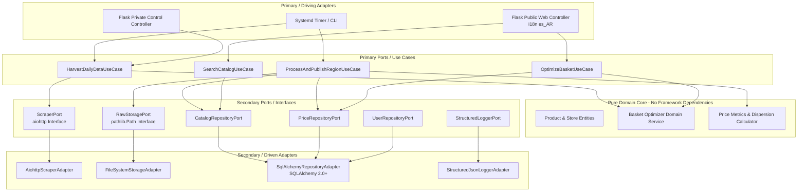

# "Sur en Precios" — Hexagonal System Architecture & Design Specification

> **System Overview**: "Sur en Precios" is a clean, non-overengineered system for harvesting, processing, analyzing, and querying daily supermarket price data from Argentina's official SEPA (*Precios Claros*) dataset (`datos.produccion.gob.ar/dataset/sepa-precios`). It is built following **Hexagonal Architecture (Ports and Adapters)**, strict **Python standards**, and resource-bounded **regional deployments**.

---

## 🏛️ 1. Architecture & Hexagonal Design (Ports & Adapters)

The system isolates core domain logic (basket optimization, price statistics, data normalization) from external frameworks, databases, and I/O mechanisms.



---

## 📋 2. Official SEPA Dataset Integration (Metadata Anexo II Specs)

The harvester processes daily `.zip` archives published by Argentina's Ministry of Production (`sepa.zip`), formatted as pipe-delimited UTF-8 CSVs (`|` separator, `\r\n` line endings).

### Source Data Files Structure
1. **`comercio.csv`**: Chain/Brand metadata (`id_comercio`, `id_bandera`, `comercio_cuit`, `comercio_razon_social`, `comercio_bandera_nombre`, `comercio_bandera_url`, `comercio_ultima_actualizacion`, `comercio_version_sepa`).
2. **`sucursales.csv`**: Store branch catalog (`id_comercio`, `id_bandera`, `id_sucursal`, `sucursales_nombre`, `sucursales_tipo` [Hipermercado, Supermercado, Autoservicio, Tradicional, Web], `sucursales_calle`, `sucursales_numero`, `sucursales_latitud`, `sucursales_longitud`, `sucursales_barrio`, `sucursales_codigo_postal`, `sucursales_localidad`, `sucursales_provincia` [ISO 3166-2 e.g. AR-B], opening hours).
   - *Note*: Latitude and longitude are optional/nullable (web stores and certain rural branches omit coordinates).
3. **`productos.csv`**: Daily branch prices (`id_comercio`, `id_bandera`, `id_sucursal`, `id_producto`, `productos_ean` [1=GTIN/EAN, 0=Internal], `productos_descripcion`, `productos_cantidad_presentacion`, `productos_unidad_medida_presentacion`, `productos_marca`, `productos_precio_lista` [Regular Price], `productos_precio_referencia`, `productos_cantidad_referencia`, `productos_unidad_medida_referencia`, `productos_precio_unitario_promo1`, `productos_leyenda_promo1`, `productos_precio_unitario_promo2`, `productos_leyenda_promo2`).

---

## 📦 3. Technical Stack & Coding Standards

| Layer / Component | Technology & Standards | Requirements |
| :--- | :--- | :--- |
| **Package Management** | **`uv`** | Official package manager (`pyproject.toml`, `uv.lock`, `uv run`, `uv sync`). *Websites deployed on PythonAnywhere use virtualenvs as provided by environment.* |
| **Project Layout** | `src/` layout | Canonical structure (`src/sur_en_precios/...`, `tests/`). |
| **File System API** | **`pathlib.Path` ONLY** | 🚨 **`os.path` and `os.makedirs` are strictly BANNED.** |
| **Database Access** | **SQLAlchemy 2.0+ ORM** | 🚨 **Direct SQL query strings are strictly BANNED.** Uses `Mapped[...]` and `mapped_column(...)` Declarative Base, and `Session.execute(select(...))` APIs. |
| **Configuration** | **YAML + Pydantic** | Configured via `config.yaml` located in dynamically resolved `--workdir` / `WORKING_DIRECTORY` (fallback `~/Info/sur_en_precios/`). Includes `--create` flag generation. |
| **HTTP Client** | Python **`aiohttp`** | 🚨 **`httpx` and `requests` are strictly BANNED.** |
| **Currency & Prices** | **Integer Pesos Argentinos (ARS)** | Prices are rounded to integer Pesos Argentinos ($P = \text{round}(P)$). Trailing cents are omitted. |
| **Codebase & UI Language** | English Code + **i18n (es_AR)** UI | All Python code (variables, functions, docstrings) in **English**. All UI templates in **Argentine Spanish (`es_AR`)** with **ZERO hardcoded text strings** (uses Flask-Babel). |
| **Logging & Monitoring** | **Structured JSON Logging** | Extensively logged with `python-json-logger` / `structlog` + file rotation (`RotatingFileHandler`) + Log Analysis CLI utility. |
| **Testing** | **Pytest** | Full unit and integration test suite covering domain core, repositories, and controllers. |

---

## 📁 4. Canonical Project Repository Layout

```
sur-en-precios/
├── .venv/                      # Managed by uv (git ignored)
├── config.yaml                 # Sample working directory config
├── pyproject.toml              # Project metadata, uv sources, ruff/pytest/mypy config
├── uv.lock                     # Locked dependencies
├── .python-version             # Python version (e.g. 3.12)
├── README.md                   # Installation, config, init, execution instructions
├── src/
│   └── sur_en_precios/
│       ├── __init__.py
│       ├── config.py           # Pydantic AppConfig & read_config()
│       ├── domain/             # PURE DOMAIN CORE (No framework imports)
│       │   ├── __init__.py
│       │   ├── models.py       # Dataclasses/Entities: Product, Store, Price, Basket
│       │   ├── services.py     # BasketOptimizer, GeometricMeanCalculator
│       │   └── ports.py        # Abstract Base Classes (Repositories, Harvester, Storage)
│       ├── adapters/           # DRIVEN ADAPTERS
│       │   ├── __init__.py
│       │   ├── harvester.py    # AiohttpScraperAdapter (aiohttp only)
│       │   ├── storage.py      # FileSystemStorageAdapter (pathlib.Path only)
│       │   ├── database/       # SQLAlchemy 2.0+ Repositories & Models
│       │   │   ├── __init__.py
│       │   │   ├── models_user.py    # user_data.sqlite ORM models
│       │   │   ├── models_public.py  # public.sqlite ORM models
│       │   │   └── repositories.py   # SQLAlchemy Repository implementation
│       │   └── logging.py      # Structured JSON Logger & RotatingFileHandler
│       ├── use_cases/          # APPLICATION USE CASES (Driving Ports)
│       │   ├── __init__.py
│       │   ├── harvest_data.py
│       │   ├── process_region.py
│       │   └── optimize_basket.py
│       ├── web/                # FLASK WEB APPLICATIONS (Driving Adapters)
│       │   ├── control_app/    # Private Control Web App
│       │   │   ├── app.py
│       │   │   └── templates/
│       │   ├── public_app/     # Public Web App (PythonAnywhere)
│       │   │   ├── app.py
│       │   │   ├── translations/ # Babel es_AR locale catalog
│       │   │   ├── static/       # Vanilla CSS / JS
│       │   │   └── templates/
│       └── tools/              # CLI UTILITIES
│           ├── __init__.py
│           └── log_analyzer.py # Structured Log Search & Analysis CLI
└── tests/                      # PYTEST TEST SUITE
    ├── __init__.py
    ├── unit/
    │   ├── test_basket_optimizer.py
    │   ├── test_metrics_calculator.py
    │   └── test_config.py
    └── integration/
        ├── test_sqlalchemy_repos.py
        └── test_aiohttp_harvester.py
```

---

## 🗄️ 5. SQLAlchemy 2.0+ Declarative Models

> 🚨 **Direct SQL query strings are banned.** All database structures use SQLAlchemy 2.0+ `Mapped` type annotations.

### `user_data.sqlite` Models (Persistent User DB on PythonAnywhere)
```python
from datetime import datetime
from typing import List
from sqlalchemy import String, Integer, DateTime, ForeignKey
from sqlalchemy.orm import DeclarativeBase, Mapped, mapped_column, relationship

class UserBase(DeclarativeBase):
    pass

class UserModel(UserBase):
    __tablename__ = "users"

    id: Mapped[int] = mapped_column(Integer, primary_key=True, autoincrement=True)
    email: Mapped[str] = mapped_column(String(255), unique=True, nullable=False, index=True)
    password_hash: Mapped[str] = mapped_column(String(255), nullable=False)
    created_at: Mapped[datetime] = mapped_column(DateTime, default=datetime.utcnow)

    shopping_lists: Mapped[List["ShoppingListModel"]] = relationship(
        back_populates="user", cascade="all, delete-orphan"
    )

class ShoppingListModel(UserBase):
    __tablename__ = "shopping_lists"

    id: Mapped[int] = mapped_column(Integer, primary_key=True, autoincrement=True)
    user_id: Mapped[int] = mapped_column(ForeignKey("users.id"), nullable=False, index=True)
    name: Mapped[str] = mapped_column(String(100), nullable=False)
    created_at: Mapped[datetime] = mapped_column(DateTime, default=datetime.utcnow)

    user: Mapped["UserModel"] = relationship(back_populates="shopping_lists")
    items: Mapped[List["ListItemModel"]] = relationship(
        back_populates="shopping_list", cascade="all, delete-orphan"
    )

class ListItemModel(UserBase):
    __tablename__ = "list_items"

    id: Mapped[int] = mapped_column(Integer, primary_key=True, autoincrement=True)
    list_id: Mapped[int] = mapped_column(ForeignKey("shopping_lists.id"), nullable=False, index=True)
    ean: Mapped[str] = mapped_column(String(14), nullable=False, index=True)
    quantity: Mapped[int] = mapped_column(Integer, default=1, nullable=False)

    shopping_list: Mapped["ShoppingListModel"] = relationship(back_populates="items")
```

### `public.sqlite` Models (Daily Swapped Region Price DB)
```python
from datetime import date
from typing import Optional
from sqlalchemy import String, Integer, Float, Date, Text, ForeignKey
from sqlalchemy.orm import DeclarativeBase, Mapped, mapped_column

class PublicBase(DeclarativeBase):
    pass

class ProductModel(PublicBase):
    __tablename__ = "products"

    ean: Mapped[str] = mapped_column(String(14), primary_key=True)
    name: Mapped[str] = mapped_column(Text, nullable=False, index=True)
    brand: Mapped[Optional[str]] = mapped_column(Text, nullable=True, index=True)
    category: Mapped[Optional[str]] = mapped_column(Text, nullable=True, index=True)

class StoreModel(PublicBase):
    __tablename__ = "stores"

    id: Mapped[str] = mapped_column(String(50), primary_key=True)
    chain_name: Mapped[str] = mapped_column(Text, nullable=False)
    store_name: Mapped[str] = mapped_column(Text, nullable=False)
    address: Mapped[Optional[str]] = mapped_column(Text, nullable=True)
    city: Mapped[str] = mapped_column(Text, nullable=False, index=True)
    latitude: Mapped[Optional[float]] = mapped_column(Float, nullable=True)   # Optional per SEPA spec
    longitude: Mapped[Optional[float]] = mapped_column(Float, nullable=True)  # Optional per SEPA spec

class DailyPriceModel(PublicBase):
    __tablename__ = "daily_prices"

    date: Mapped[date] = mapped_column(Date, primary_key=True, nullable=False, index=True)
    ean: Mapped[str] = mapped_column(ForeignKey("products.ean"), primary_key=True, nullable=False)
    store_id: Mapped[str] = mapped_column(ForeignKey("stores.id"), primary_key=True, nullable=False)
    price: Mapped[int] = mapped_column(Integer, nullable=False)  # Expressed in integer Pesos Argentinos (ARS)

class DailyProductMetricModel(PublicBase):
    __tablename__ = "daily_product_metrics"

    date: Mapped[date] = mapped_column(Date, primary_key=True, nullable=False, index=True)
    ean: Mapped[str] = mapped_column(String(14), primary_key=True, nullable=False)
    city: Mapped[str] = mapped_column(Text, primary_key=True, nullable=False, index=True)
    min_price: Mapped[Optional[int]] = mapped_column(Integer)         # Integer Pesos Argentinos
    max_price: Mapped[Optional[int]] = mapped_column(Integer)         # Integer Pesos Argentinos
    median_price: Mapped[Optional[int]] = mapped_column(Integer)      # Integer Pesos Argentinos
    geo_mean_price: Mapped[Optional[int]] = mapped_column(Integer)    # Integer Pesos Argentinos
    price_dispersion: Mapped[Optional[float]] = mapped_column(Float)
    pct_change_7d: Mapped[Optional[float]] = mapped_column(Float)
    pct_change_30d: Mapped[Optional[float]] = mapped_column(Float)
    pct_change_90d: Mapped[Optional[float]] = mapped_column(Float)
```

---

## ⚙️ 6. Pydantic Configuration Schema & Standard Resolution

Configuration is resolved strictly according to Python standards (`config.md`):
1. CLI `--workdir` path argument.
2. `WORKING_DIRECTORY` environment variable.
3. Fallback default: `~/Info/sur_en_precios`.
4. CLI `--create` generates default `config.yaml`.

```python
from pathlib import Path
from pydantic import BaseModel, Field

class AppSettings(BaseModel):
    name: str = "Sur en Precios"
    region: str = "AR-B"
    debug: bool = False

class DatabaseSettings(BaseModel):
    public_db_path: str = "data/public.sqlite"
    user_db_path: str = "data/user_data.sqlite"
    control_db_path: str = "data/control.sqlite"

class ScraperSettings(BaseModel):
    sepa_url: str = "https://datos.produccion.gob.ar/dataset/sepa-precios"
    raw_storage_dir: str = "data/raw"
    timeout_seconds: int = 120

class LoggingSettings(BaseModel):
    level: str = "INFO"
    log_dir: str = "logs"
    max_bytes: int = 10_485_760  # 10MB
    backup_count: int = 5

class AppConfig(BaseModel):
    app: AppSettings = Field(default_factory=AppSettings)
    database: DatabaseSettings = Field(default_factory=DatabaseSettings)
    scraper: ScraperSettings = Field(default_factory=ScraperSettings)
    logging: LoggingSettings = Field(default_factory=LoggingSettings)
```

---

## 📊 7. Structured Logging & Log Analysis Utility

As mandated by `logging.md` for multi-module applications, structured logging output is recorded to both `stdout` and rotated JSON log files (`logs/sur_en_precios.log.json`).

### Structured Log Format Example
```json
{
  "timestamp": "2026-10-09T16:55:00Z",
  "level": "INFO",
  "module": "use_cases.process_region",
  "event": "etl_region_completed",
  "region": "AR-B",
  "duration_ms": 4250,
  "records_ingested": 185400,
  "products_updated": 14200,
  "stores_updated": 120
}
```

### Log Analyzer CLI Tool (`tools/log_analyzer.py`)
A CLI utility is provided to query, filter, and summarize application logs:
```bash
uv run python -m sur_en_precios.tools.log_analyzer --level ERROR --since 24h
uv run python -m sur_en_precios.tools.log_analyzer --event etl_region_completed --summary
```

---

## 🧪 8. Quality Assurance & Pytest Strategy

Testing adheres to `quality-assurance.md` standards using **Ruff**, **Mypy**, and **Pytest**:

1. **Linting & Formatting**:
   ```bash
   uv run ruff check .
   uv run ruff format .
   ```
2. **Type Checking**:
   ```bash
   uv run mypy src/
   ```
3. **Automated Testing Suite**:
   ```bash
   uv run pytest
   ```
   - **Unit Tests**: Test core domain logic (`BasketOptimizer` total calculation, geometric mean calculation, price dispersion math, Pydantic configuration parser).
   - **Integration Tests**: Test SQLAlchemy 2.0 repository CRUD operations, SQLite FTS5 search queries, and mock `aiohttp` harvester streaming.

---

## 🌐 9. UI Internationalization (es_AR) & Basket Matrix Design

1. **Zero Hardcoded Strings**: All UI text is wrapped in Flask-Babel `_()` calls with translation files in `src/sur_en_precios/web/public_app/translations/es_AR/LC_MESSAGES/messages.po`.
2. **Argentine Regionalization**:
   - Currency rendered as whole Pesos Argentinos (e.g. `$1.450`).
   - Store status badges: **Menor Precio (Verde)**, **Mayor Precio (Rojo)**, **Por encima de la Media Geométrica**.
3. **Basket Matrix Logic**:
   - Compares total basket price across stores in the selected city & date.
   - Separate view for item-by-item optimal allocation across multiple stores.
   - Partial availability handling: Stores missing 1 or more items are flagged with missing item counts, ensuring exact basket totals are strictly computed on 100% matched items.
